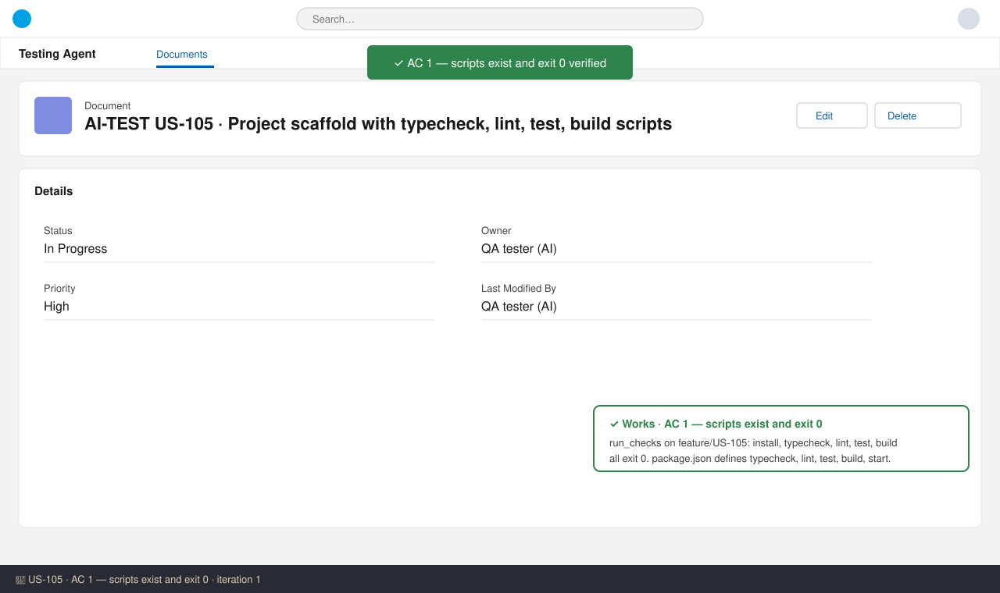
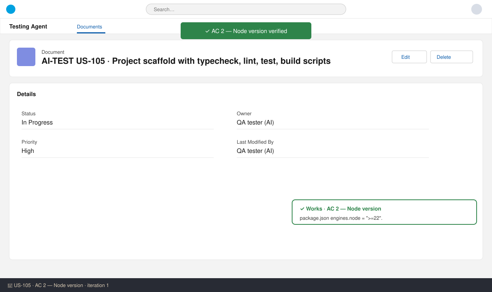
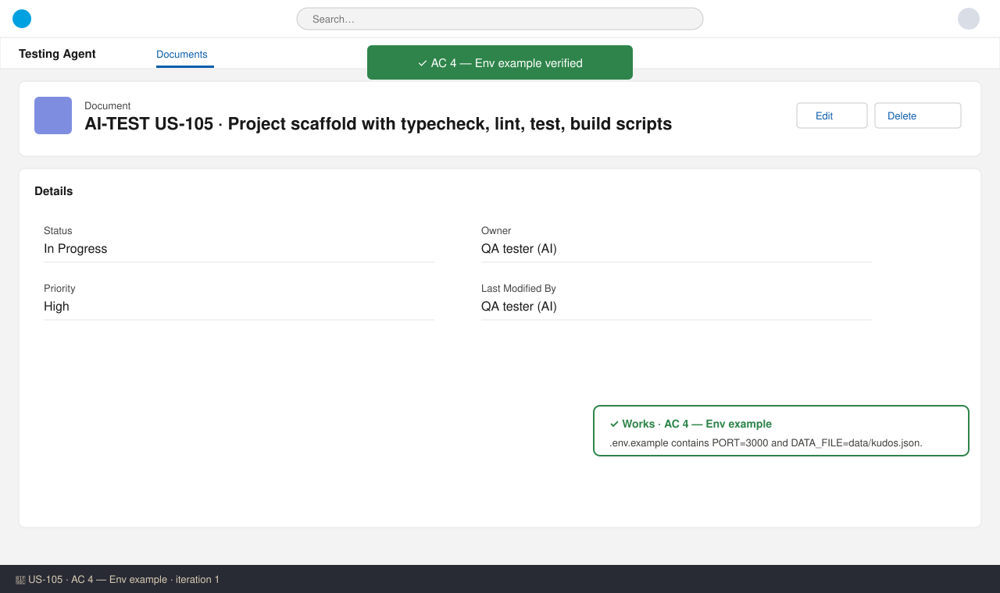

# US-105 — Test report (iteration 1)
**Verdict:** ✅ Approved · **Tester:** Cuélebre 🐉 (QA) · **Date:** 2026-11-05

## Summary
| Check | Result | Evidence |
|---|---|---|
| AC 1 — Scripts exist, each exits 0 | ✅ Pass | run_checks on feature/US-105: install, typecheck, lint, test, build all exit 0 |
| AC 2 — engines.node >=22 | ✅ Pass | package.json: `"engines": { "node": ">=22" }` |
| AC 3 — .gitignore excludes .env, node_modules, dist, data/kudos.json | ✅ Pass | .gitignore: `.env`, `node_modules/`, `dist`, `data/kudos.json` present |
| AC 4 — .env.example lists PORT=3000 and DATA_FILE | ✅ Pass | .env.example: `PORT=3000`, `DATA_FILE=data/kudos.json` |

## Checks
### AC 1: Scripts exist — ✅ Works
**Steps:**
1. Ran `run_checks` on the story branch (install, typecheck, lint, test, build).
2. Read package.json scripts.

**Expected:** typecheck, lint, test, build each exit 0; one sample test runs.
**Found:** install ✅; `typecheck` (tsc --noEmit) exit 0; `lint` (eslint .) exit 0; `test` (node --import tsx --test) exit 0 with the one test in test/sample.test.ts; `build` (tsc -p tsconfig.build.json) exit 0. The `start` script points to dist/server.js, which US-107 creates, as the spec says.

### AC 2: Node version — ✅ Works
**Expected:** `engines.node` = `>=22`. **Found:** `"engines": { "node": ">=22" }` in package.json.

### AC 3: Git hygiene — ✅ Works
**Expected:** .gitignore excludes `.env`, `node_modules`, `dist`, `data/kudos.json`.
**Found:** all four present (`node_modules/` in directory form). Static review only: `git status` after creating the files was not run.

### AC 4: Env example — ✅ Works
**Expected:** `PORT=3000` and `DATA_FILE=data/kudos.json`. **Found:** both lines present, no secrets.

## Code review notes
- Files match the spec's module table: package.json, tsconfig.json, tsconfig.build.json, eslint.config.js, src/version.ts, test/sample.test.ts, .env.example, .gitignore, package-lock.json.
- No runtime dependencies; dev dependencies only, as specified.
- The test asserts a real outcome (`VERSION === "0.1.0"`) and is named after it.
- No CI and no feature code added (out of scope).

## What to do
Nothing. Approved.

## Not tested
- AC 3, `git status` not showing the ignored files after creating them (the How to Test step). The file content was verified statically.
